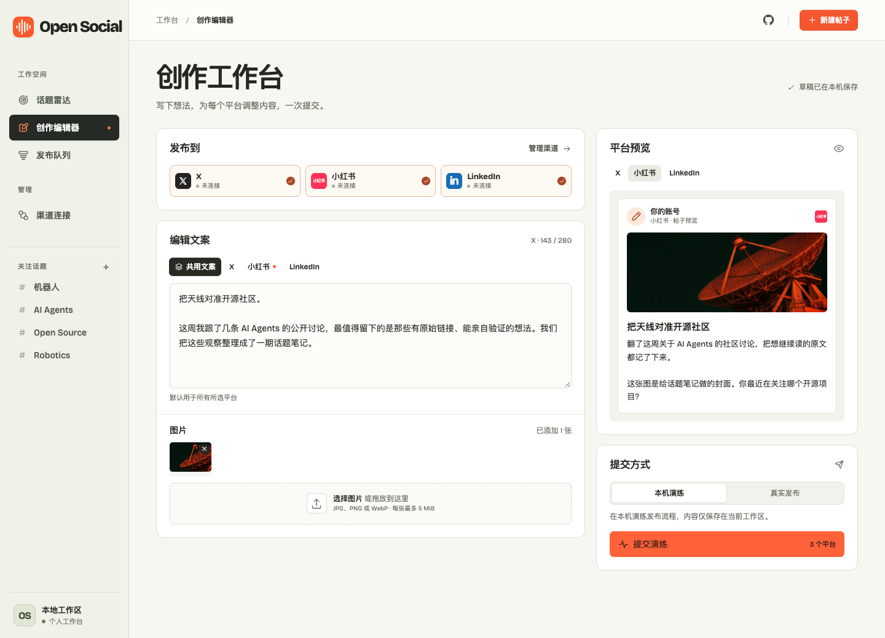
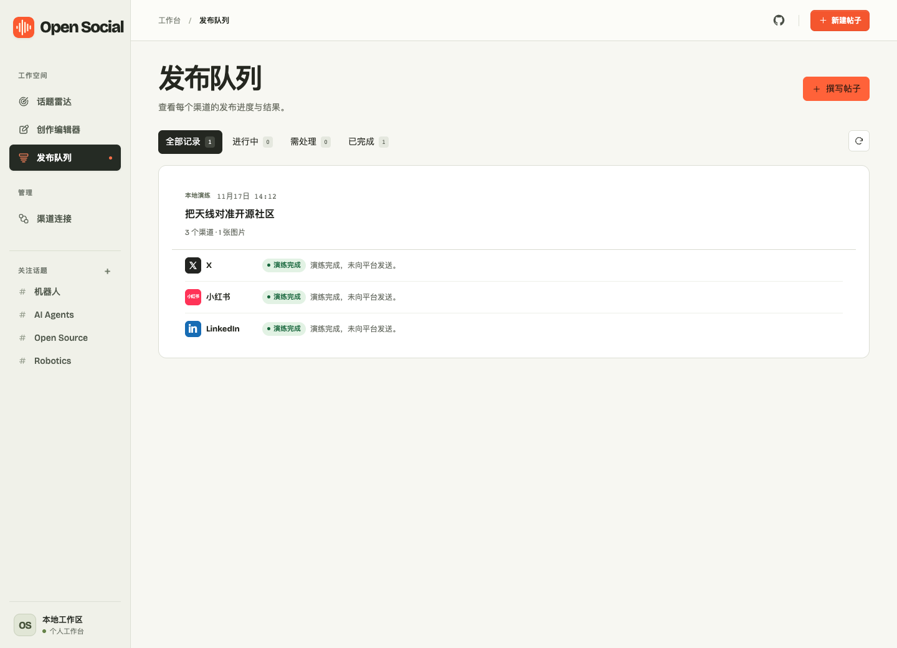

# Open Social

追一个话题，找到值得引用的原文，写一次图文，把它发到 X、小红书和 LinkedIn。

Open Social 是一个本机运行的中文社媒工作台。公开话题搜索开箱可用。发布时可以共用文案，也可以给每个平台单独改稿。提交后由后台逐个投递，关掉浏览器也能继续。


## 五分钟跑通第一条图文

需要 Node.js 22.16 或更高版本和 npm。

```sh
git clone https://github.com/kapelame/open-social.git
cd open-social
npm ci
npm start
```

1. **打开工作台。** 访问 [http://127.0.0.1:4317](http://127.0.0.1:4317)。首页载入「AI Agents」样本，可以打开每条记录的原帖或引用的外链。图表下方显示采集日期和数据状态。
2. **找一个选题。** 搜索「机器人」或其他关键词，切换近 7 天、近 30 天与平台筛选。点击「关注话题」可把搜索保留在侧栏，点击「引用创作」会把标题与原文链接带进草稿。
3. **试发一份草稿。** 在编辑器写共同文案，上传图片，勾选 X、小红书和 LinkedIn。点击平台名可以调整专属文案，小红书标题默认取正文首行。检查预览后选择「本机演练」提交。队列会分别显示三个渠道的演练结果。
4. **连接账号，正式发布。** 在「渠道连接 → 配置渠道」保存应用凭证，或检测本机小红书桥接器并扫码。授权后回到编辑器选择「真实发布」。保持 Node 服务和所需桥接器运行即可离开网页，回来看每个平台的回执。[首次连接步骤](docs/setup.md) · [开发者应用配置](docs/channels.md) · [小红书接入指南](docs/xiaohongshu.md)



## 搜索与发布范围

| 平台 | 话题发现 | 图文发布 |
| --- | --- | --- |
| Hacker News | 帖子、积分和原文，无需密钥 | — |
| GitHub | 时间窗口内新建的公开仓库，按当前星标排序 | — |
| X | 配置有权限的搜索凭证，可检索近 7 天 | 用户 OAuth 或用户令牌，支持多图 |
| 小红书 | 已登录的自托管桥接器可检索笔记 | 通过同一社区桥接器投递图文，首次需要扫码 |
| LinkedIn | 可跳转到 LinkedIn 站内搜索 | 个人账号授权，支持单图和多图 |
| Bluesky | 使用公开搜索接口，结果受上游访问权限影响 | — |

**读懂曲线。** 每个点代表该 UTC 日期落入本次检索的样本数量。Hacker News、GitHub、X 和 Bluesky 单次各取最多 40 条，小红书抽取最多 6 篇笔记。不同来源保留自己的计量单位，综合榜交替展示来源。30 天图展示新时间窗口的样本，每个平台的取样上限相同。来源拒绝访问、超出时间范围或缺少凭证时，界面会显示原因。

**读懂回执。** 发布队列保存在 SQLite。一次提交使用同一请求编号，重复点击或重试网络请求可以取回原任务。每个平台独立记录结果。服务会对明确未送达的临时错误退避重试。遇到已发出但未收到确认的请求，队列标记「待核实」，先去账号主页核对。X 和 LinkedIn 支持从成功回执打开原帖；小红书桥接确认的是创作中心已提交，公开状态取决于平台审核。



## 运行与开发

- **单用户本机服务。** 默认仅监听回环地址。浏览器保存未发布草稿和关注话题，服务端在 `.data/` 保存图片、任务和本地授权文件。备份时先停服务，再复制数据目录。草稿随浏览器及访问地址保存。
- **环境变量。** 可复制 [.env.example](.env.example) 为 `.env` 并填写需要的字段。可以通过 `PORT` 修改端口，通过 `OPEN_SOCIAL_DATA_DIR` 指定数据目录。
- **技术栈。** 原生浏览器 ES 模块、Node HTTP 服务和内置 SQLite。前端无需构建，字体和主图随仓库分发。
- **验证。** 运行 `npm test` 检查搜索、OAuth、媒体上传、多图发布适配、重复提交和重启后的队列恢复。适配器测试使用模拟平台回执。真实账号的发布权限和额度需要在账号接入后核实。

[查看渠道连接界面](docs/screenshots/channels.png) · [查看手机界面截图](docs/screenshots/mobile.png) · [查看主图与 ImageGen 提示词](docs/art-direction.md)

## 设计参考与许可

- **发布工作流**借鉴 Postiz 的主稿、逐平台调整和队列确认，将不同平台的发布结果汇总到同一任务中。[Postiz](https://github.com/gitroomhq/postiz-app)
- **话题工作流**参考 TrendRadar 的关键词和来源筛选，以及 NewsNow 的多源内容直达原文。这里的热度展示使用可检查的样本数量。[TrendRadar](https://github.com/sansan0/TrendRadar) · [NewsNow](https://github.com/newsnext/newsnow)

项目代码采用 [MIT 许可证](LICENSE)。随附 Bricolage Grotesque 字体使用 [SIL Open Font License](public/fonts/OFL.txt)。射电天线主图使用内建 ImageGen 生成，产品截图来自运行中的工作台。
